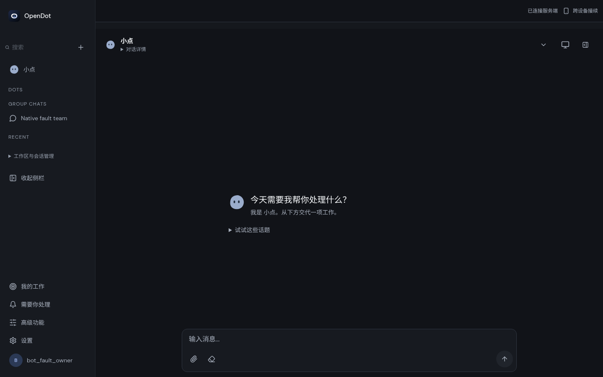
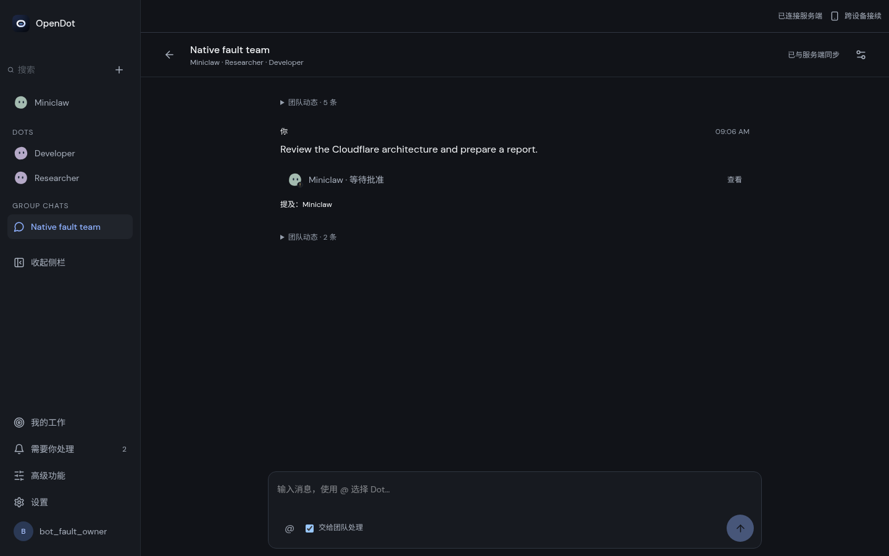
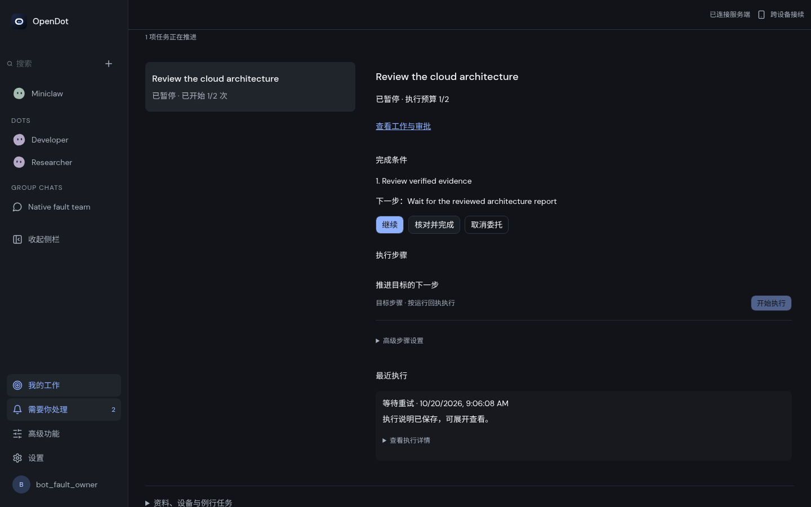
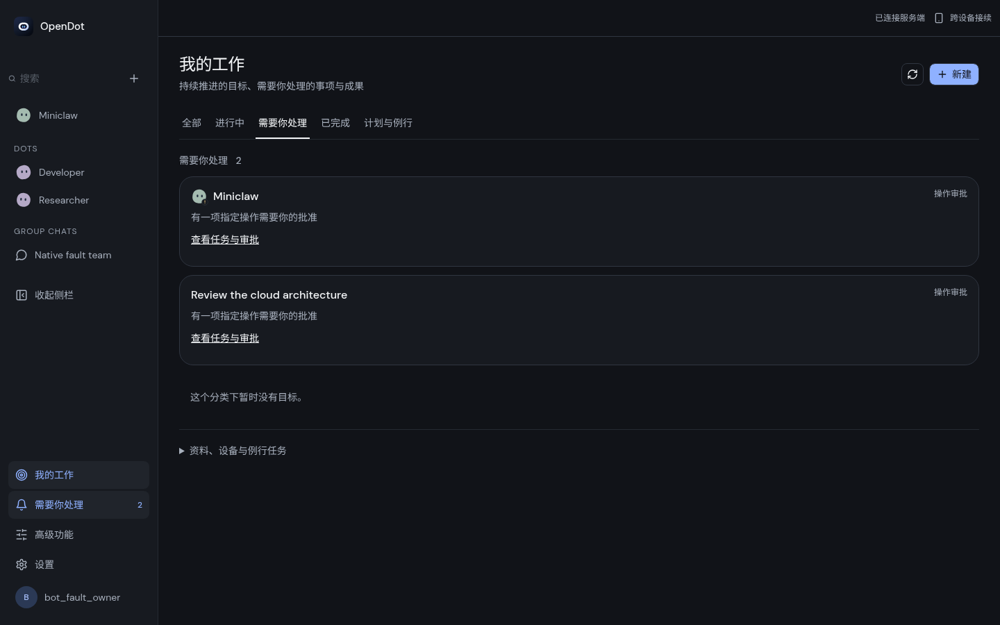
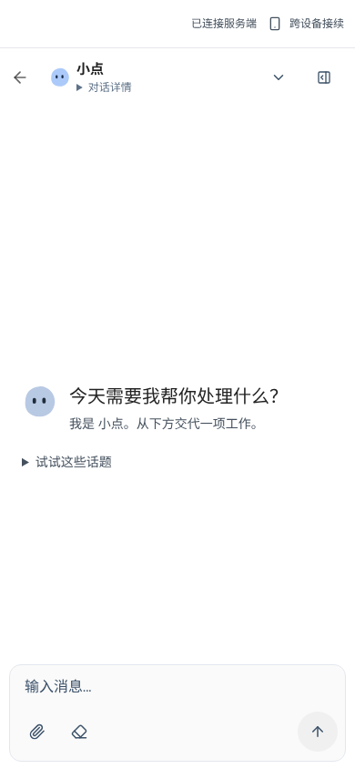
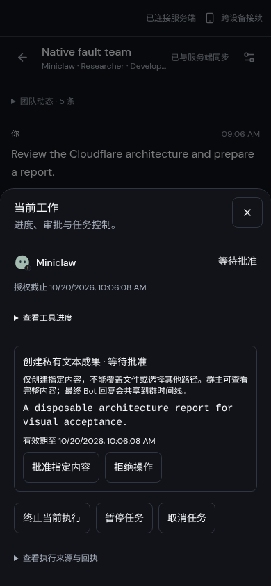
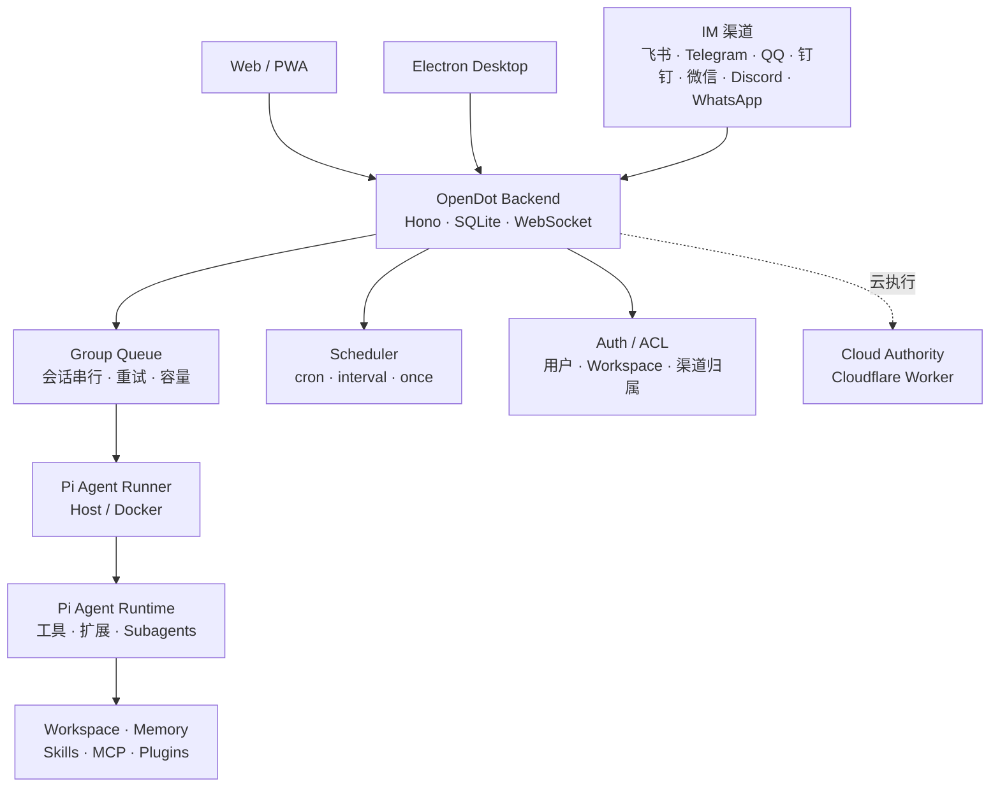

<div align="center">


# OpenDot

**可以直接对话、持续接受委托的个人 AI 助手与团队。**

[](https://opendot.helson.top/mobile)

**[手机 / 电脑打开即用，无需安装与注册](https://opendot.helson.top/mobile)** · 演示数据全部虚构

[](package.json)
[](tsconfig.json)
[](web/package.json)
[](electron)
[](src/db.ts)
[](web)
[](LICENSE)
[](#快速开始)

[在线演示](https://opendot.helson.top/mobile) · [核心功能](#核心功能) · [架构](#架构) · [快速开始](#快速开始) · [安全边界](#安全边界)



</div>

> **English** — OpenDot (compatibility name: Miniclaw) is a self-hosted, multi-user agent workbench built on Pi Agent Runtime. Each agent has a profile, its own workspace, isolated sessions, memory and channels, and runs either on the host or inside a Docker runner.

---

## 这是什么

OpenDot 是一个自托管的多用户 Agent 工作台。它把"一个能持续干活的助手"拆成三层可管理的对象：

```text
Agent Profile        身份 · 四段 Prompt · 模型 · 能力策略
└── Workspace        文件目录 · 执行模式 · 环境变量 · 渠道绑定
    ├── Main Session
    ├── Runtime Session   独立 Pi 上下文，可绑定私聊
    ├── Native Context    飞书话题等原生线程
    └── Scheduled Run     cron / interval / once
```

同一个 Workspace 里的会话共享工作区文件，但各自拥有独立的 Pi Session——**文件隔离与上下文隔离是两件事**，OpenDot 把它们分开建模。

Web、PWA、Electron 桌面端和七个 IM 渠道都是同一后端的入口：你在群里 @ 它、在手机上打开它、在桌面客户端里继续同一个 Session，都会落到同一份工作区、记忆和权限边界上。

---

## 核心功能

### Agent Profile 与 Workspace

- 每个 Agent 用四段 Prompt 描述自己：`IDENTITY`（身份与边界）、`SOUL`（价值观与表达）、`AGENTS`（工作流与失败处理）、`TOOLS`（能力选择方式）。
- Workspace 拥有独立的文件目录、Session、Memory、渠道绑定和执行边界；支持创建、重命名、重建、清空与删除。
- Home Workspace 与自定义 Agent 分层管理；宿主机 Skills 由独立策略选择，不会被某个开关隐式带上。

### Pi Agent Runtime

- 基于 Pi Agent Runtime 提供流式输出、工具调用、Session 持久化与恢复。
- 支持 abort、follow-up、原生 compaction，Session 以 JSONL 持久化。
- MCP capability 映射为稳定的 `mcp__miniclaw__*` 工具；Subagents 通过扩展与显式 spawn/stop 生命周期桥接。
- 不会假装拥有缺失能力：尚未接入的 Web Search / Web Fetch 明确显示为不可用。

### Memory 与上下文

- 记忆按 Workspace 隔离，不跨工作区隐式共享。
- 区分事实、偏好、决策与经验四类知识，支持搜索、编辑、忘记与版本历史。
- 写入使用 revision + compare-and-set，避免并发编辑互相覆盖。
- 每条记忆记录来源 Session、来源类型、观察时间与变更历史，便于回溯 provenance。
- Runtime 只注入当前 Workspace 允许使用的记忆，平台身份约束不会被当作普通用户记忆注入。

### Skills、MCP 与 Plugins

- 内置、宿主机、项目、用户、Workspace 与 Plugin 六层 Skills 统一解析。
- 能力库集中展示 Skills / MCP / Plugins 的可用状态、依赖与能力预览。
- Agent 运行前计算**有效能力 Manifest**，把 Skills、MCP、Memory、Workspace 与渠道上下文按策略注入，并记录来源与预算。
- 路径穿越、符号链接逃逸、越权 Workspace 与未授权 capability 在边界层拒绝。

### 渠道与自动化

- 支持飞书、Telegram、QQ、钉钉、微信、Discord 与 WhatsApp；消息按用户、群聊、话题与 owner 规则做 ACL 判断。
- 渠道账号可多开：同一 Provider 下多个账号，发送时使用绑定账号的机器人身份。
- Scheduler 支持 cron、固定间隔与一次性任务，提供立即运行、暂停、取消、运行历史与结果投递。
- 渠道可靠性走 Inbox / Turn / Outbox / 流式卡片状态机，失败有界退避，重启可恢复。

### Electron 桌面端

- Electron 只是 Desktop Shell，复用同一套 Web Client；Renderer 不承载数据库、文件系统、凭证或 shell 权限。
- Main Process 负责窗口生命周期、外部链接、菜单与受限 IPC，Preload 只暴露白名单 API。
- 同一套 Renderer 既能连本地后端，也能通过 `MINICLAW_SERVER_URL` 连远程实例。

---

## 界面

| 桌面端对话 | 群聊时间线 |
| --- | --- |
|  |  |
| **目标与待办** | **需要你处理的事** |
|  |  |
| **移动端对话** | **移动端审批** |
|  |  |

> 截图来自隔离的 HTTP/SQLite 测试环境，任务推理、触屏与键盘操作为模拟；客户与数据均为虚构。

---

## 架构



| 层 | 职责 | 位置 |
| --- | --- | --- |
| 后端 | HTTP / WebSocket、消息消费、渠道路由、调度、SQLite 持久化 | `src/` |
| Web 客户端 | React 19 + Vite + Tailwind 4 + Zustand + Radix | `web/` |
| Agent Runner | Host 与 Container 两种执行模式的统一入口 | `container/agent-runner/` |
| 桌面壳 | main / preload / 打包配置 | `electron/` |
| 共享类型 | StreamEvent 等跨端类型（由脚本同步副本） | `shared/` |
| 云执行 | Cloudflare Worker 侧的执行与签名校验 | `apps/cloud-agent/` |

### 两种执行模式

| 模式 | 行为 | 边界 |
| --- | --- | --- |
| **Host** | Runner 作为宿主机 Node 进程运行，工作区目录直接可见 | 同一 Session 串行；不设应用层全局并发上限 |
| **Container** | Runner 在非 root Docker 容器内运行，按需只读/读写挂载 | 受 `MAX_CONCURRENT_CONTAINERS` 与用户计费配额限制 |

两种模式共用同一套 Session、能力清单与 Prompt 组装；容器模式额外获得文件系统隔离。

---

## 快速开始

### 在线体验

浏览器或手机直接打开 **<https://opendot.helson.top/mobile>** —— 无需注册，演示数据全部虚构。

### 本地运行

环境要求：Node.js 22.19+（推荐 24 LTS）、npm、GNU Make；容器执行模式需要 Docker。

```bash
git clone https://github.com/kbkb628/opendot.git
cd opendot

npm install
npm --prefix web install
npm --prefix container/agent-runner install

# 首次安装或依赖更新后构建 Backend、Web 与 Agent Runner
npm run build:all

# 启动本地服务
npm start
```

打开 <http://localhost:3000/setup> 完成首个管理员初始化，然后按引导配置模型 Provider 与渠道账号。

开发模式：

```bash
make dev          # 前后端一起起（首次会自动装依赖、拉容器镜像）
make dev-backend  # 只起后端（tsx 直跑 TS）
npm run dev:web   # 只起前端
```

桌面端：

```bash
npm run desktop:dev       # 构建 main/preload 并启动 Electron
npm run desktop:package   # 生成当前平台安装包
```

本地免登录演示（仅回环地址生效）：设置 `MINICLAW_DEMO_OPEN=true` 后访问 <http://127.0.0.1:3000/>，细节见 [`DEMO.md`](DEMO.md)。

---

## 项目结构

```text
src/                    后端：HTTP/WS、消息消费、渠道、调度、SQLite 与鉴权
web/                    React 19 + Vite 前端（Web / PWA）
container/agent-runner/ Pi Agent Runner（Host / Container 共用）
electron/               桌面壳：main、preload 与打包配置
shared/                 跨端共享类型（StreamEvent 等）
apps/cloud-agent/       Cloudflare Worker 云执行侧
scripts/                安装、类型同步、内置 Skills 与运维脚本
assets/                 文档与演示截图
```

更多约定见 [`DESIGN.md`](DESIGN.md)（前端视觉与交互真相源）与 [`DEMO.md`](DEMO.md)（本地免登录演示）。

> 本仓库是面向展示与二次分发的运行版：内部设计文档、研究记录、验证证据与测试套件未随包发布，仓库中不包含 `test` 脚本与测试配置。

---

## 常用命令

| 命令 | 用途 |
| --- | --- |
| `make install` | 安装三个 Node 项目的依赖并构建 Agent Runner |
| `make dev` | 前后端开发模式 |
| `make start` | 生产式本地启动（前台） |
| `make build` | 构建后端、前端与 Agent Runner |
| `make typecheck` | 全量类型检查 |
| `make format-check` | 代码格式检查 |
| `make docker-pull` | 拉取 Agent Runner 容器镜像 |
| `make backup` / `make restore` | 运行时数据备份与恢复 |
| `make stop` / `make status` | 停止服务 / 查看状态 |

---

## 安全边界

- **Workspace 隔离**：文件、Session、Memory 与渠道绑定都以 Workspace 为单位，`created_by` 隔离且没有 admin 全局旁路。
- **能力最小化**：Agent 运行前计算有效能力 Manifest，容器模式逐个只读挂载选中的 Skill。
- **渠道归属**：一个逻辑 Session 的首个原生渠道通过 `setSessionChannelOwnerOnce()` 持久化，后续不会因重启或恢复绑定而回退。
- **破坏性操作**：IM 破坏性命令受 `OWNER_REQUIRED_IM_COMMANDS` 与渠道原生 sender ID 约束。
- **凭证**：Cookie 会话使用 HMAC 签名，密钥来自环境变量或持久文件；模型与渠道凭据在服务端保存，不写入日志。
- **演示开关**：`MINICLAW_DEMO_OPEN` 只在 TCP 对端为回环地址时生效，公网用户拿不到演示会话。

---

## 状态

内部研发版本，主线围绕 Agent Profile、Workspace 隔离、多 Agent 群聊协作、记忆版本化、能力治理与云执行边界持续迭代。真实模型与真实渠道的联调、容器执行与权限矩阵均有独立的验收记录。

---

## 许可

本项目以 [MIT License](LICENSE) 发布。
